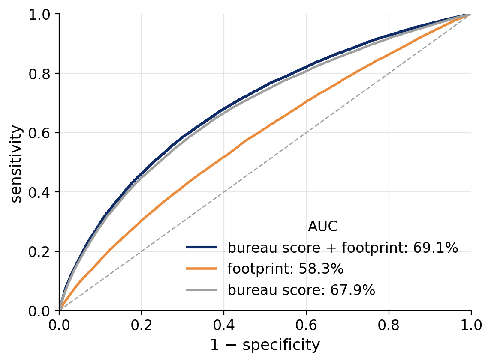
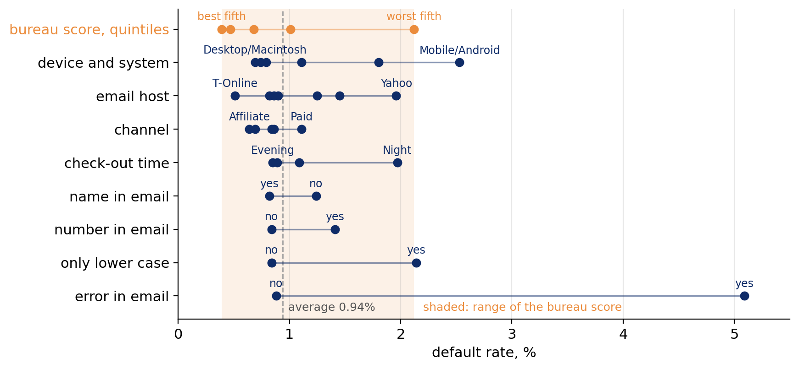
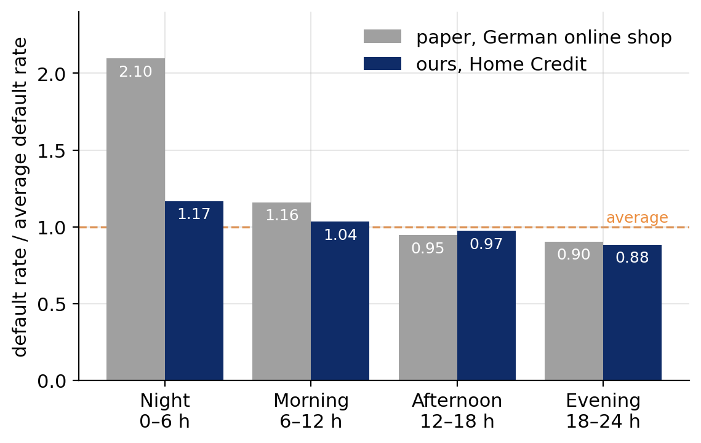
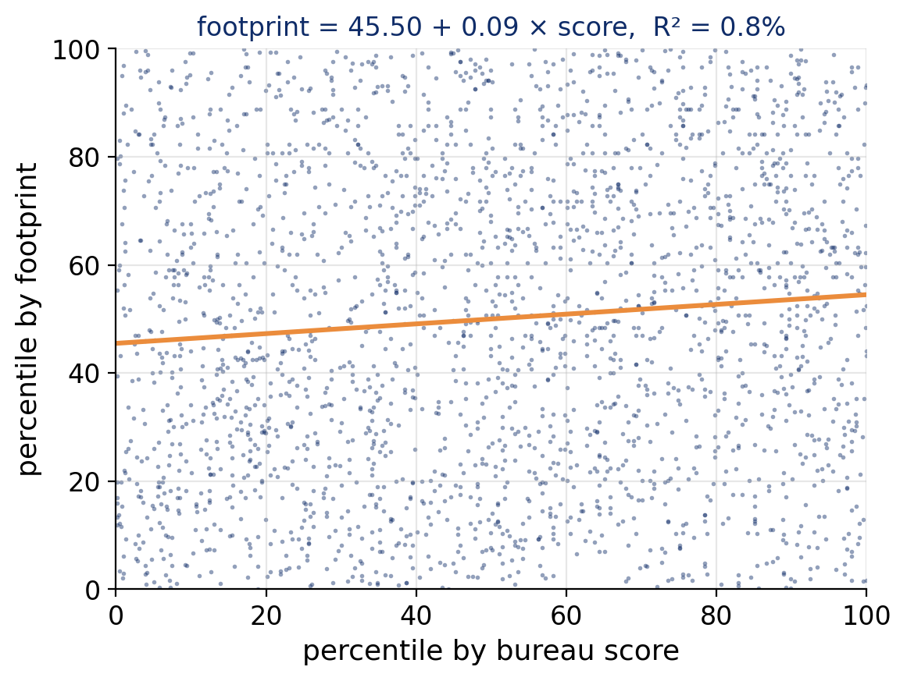
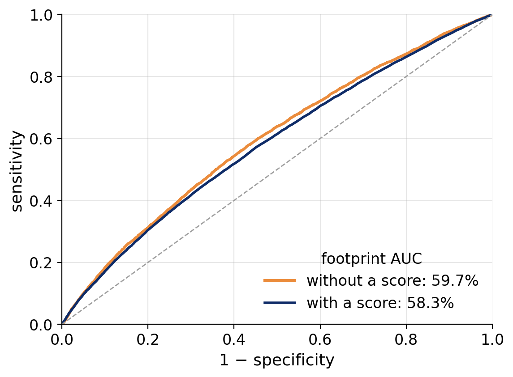
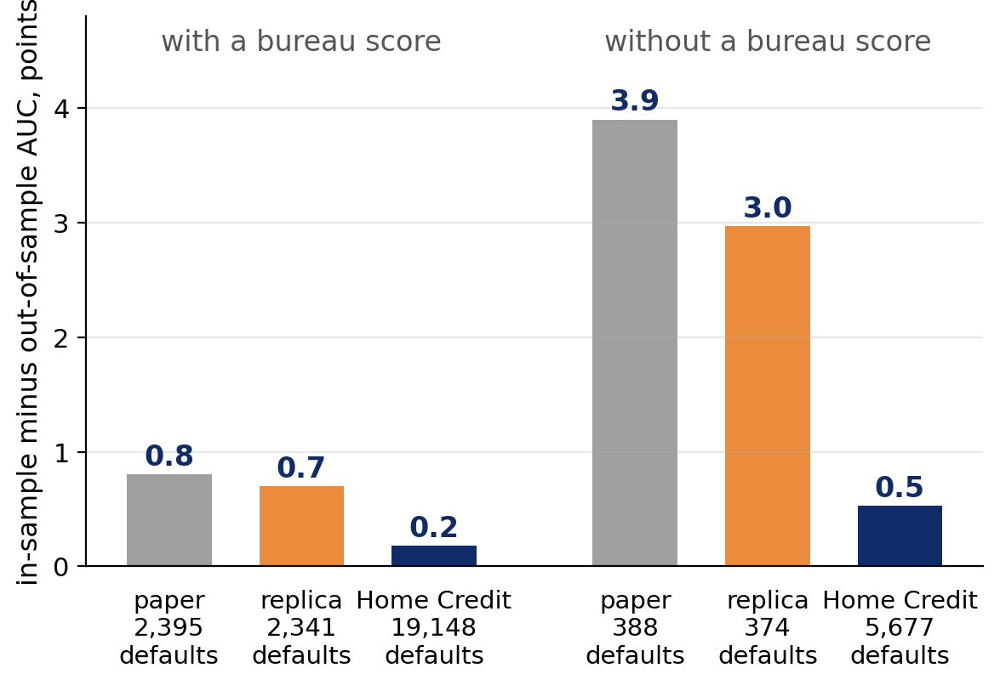

# Credit Scoring Using Digital Footprints

> **Can the traces a customer leaves on a website replace a credit bureau?**

A reproduction and replication of [Berg, Burg, Gombovic and Puri (2020)](https://doi.org/10.1093/rfs/hhz099) for the HSE University Research Seminar in Data Analysis in Finance.

<p align="center">
  
  
</p>

---

## Overview

The paper demonstrates, on 254,808 purchases at a German online shop, that **ten free variables** a website records about every visitor — device, operating system, email host, browser, time of day, and email-address characteristics — predict loan default **as well as a traditional credit bureau score** (AUC 69.6 % vs 68.3 %). The two signals are nearly uncorrelated (~10 %), so combining them raises the AUC to 73.6 %.

We did two things:

1. **Synthetic replica** — reconstructed 254,808 artificial customers from the paper's published tables (shares, logit coefficients) and verified that our code reproduces the paper's ROC curves and AUCs.
2. **Independent replication on Home Credit** — ran the same methodology on 307,511 public loans from the [Home Credit Default Risk](https://www.kaggle.com/c/home-credit-default-risk) competition (Kaggle, 2018), using `EXT_SOURCE_3` as the bureau score and 9 application-level variables as the digital footprint.

### Key results

| Metric | Paper | Our replica | Home Credit |
|:---|:---:|:---:|:---:|
| AUC, bureau score only | 68.3 % | 68.5 % | 67.9 % |
| AUC, footprint only | 69.6 % | 65.0 % | 58.3 % |
| AUC, both together | 73.6 % | 73.3 % | 69.1 % |
| AUC, footprint for unscored customers | 72.2 % | 72.7 % | 59.7 % |
| Correlation between the two scores | ~10 % | 0 % (by construction) | 9 % |
| Out-of-sample AUC drop (footprint, unscored) | 3.9 pp | 3.0 pp | 0.5 pp |

**Bottom line:** four of five claims hold on new data. The footprint still adds to the bureau score, the two are almost unrelated, and the results survive out-of-sample testing. The boldest claim — that the footprint *alone* matches the bureau score — does not carry over (58.3 % vs 67.9 % on Home Credit).

---

## Repository structure

```
.
├── Digital_Footprints_reproduction.ipynb   # Full reproduction code (Python)
├── requirements.txt                        # Python dependencies
├── results.json                            # All numerical results (used by slides)
├── figures/                                # Charts produced by the notebook
│   ├── paper_spread.png                    #   Default-rate spread by footprint variable
│   ├── roc_replica.png                     #   ROC curves, synthetic replica
│   ├── roc.png                             #   ROC curves, Home Credit
│   ├── roc_unscorable.png                  #   ROC for customers without a bureau score
│   ├── time_of_day.png                     #   Default rate by time of day
│   ├── percentiles.png                     #   Score vs footprint percentile scatter
│   └── out_of_sample.png                   #   In-sample vs out-of-sample AUC gap
├── presentation/
│   ├── slides.pdf                          # Slide deck (15 slides)
│   └── speech.txt                          # Full presentation script (~15 min)
└── paper/
    └── Berg_et_al_2020.pdf                 # Original paper (RFS, 2020)
```

---

## How to run

**Requirements:** Python 3.10+

```bash
pip install -r requirements.txt
jupyter notebook Digital_Footprints_reproduction.ipynb
```

Run all cells. On the first run the notebook downloads `application_train.csv` (166 MB) from Hugging Face. A full run takes ~5 minutes, most of it the 100-repetition cross-validation.

---

## Methodology

The notebook implements three logit models of default:

| Model | Predictors | Purpose |
|:---|:---|:---|
| **Bureau score only** | Credit bureau score (quintile dummies) | Baseline |
| **Footprint only** | 10 digital footprint variables (category dummies) | Does the footprint carry information? |
| **Both together** | Score + footprint | Does the footprint add to the score? |

Models are compared by their **AUC** (Area Under the ROC Curve). Statistical significance is tested with the **DeLong test**. Overfitting is checked with **N x 2-fold cross-validation** (100 repetitions): split the data in half, train on each half and predict the other, repeat 100 times.

### Figures

<p align="center">
  
  
</p>

<p align="center">
  
  
</p>

---

## Citation

```bibtex
@article{berg2020rise,
  title   = {On the Rise of {FinTechs}: Credit Scoring Using Digital Footprints},
  author  = {Berg, Tobias and Burg, Valentin and Gombovi{\'c}, Ana and Puri, Manju},
  journal = {Review of Financial Studies},
  volume  = {33},
  number  = {7},
  pages   = {2845--2897},
  year    = {2020},
  doi     = {10.1093/rfs/hhz099}
}
```

**Data:** Home Credit Group (2018). *Home Credit Default Risk.* Kaggle competition; `application_train.csv` downloaded from a public copy on Hugging Face.

**Related:** Iyer, R., Khwaja, A., Luttmer, E. and Shue, K. (2016). Screening peers softly. *Management Science*, 62(6), 1554-1577. DeLong, E., DeLong, D. and Clarke-Pearson, D. (1988). Comparing the areas under correlated ROC curves. *Biometrics*, 44(3), 837-845.

---

## Team

**Group 7** — Research Seminar: Data Analysis in Finance, HSE University, Moscow, 2026

- Arsentyev Arseniy
- Grebennikova Polina
- Kantemirova Elizaveta
- Pushkarev Vladislav
